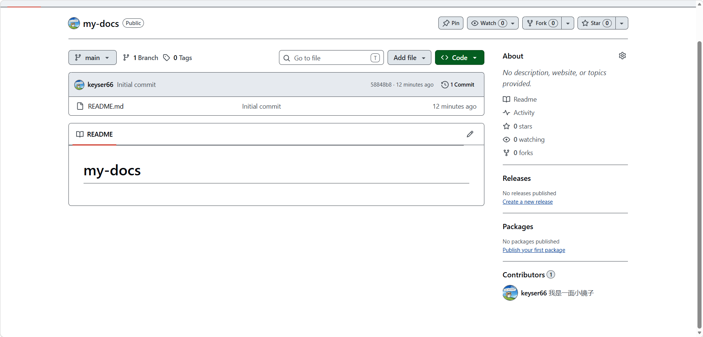
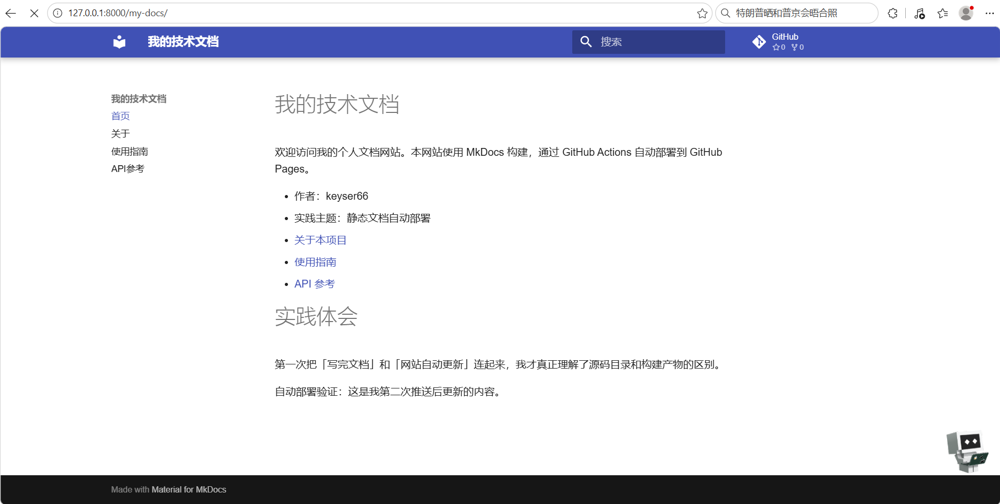

# 实践项目2：个人实验报告

## 1. 基本信息
- GitHub 登录名：keyser66
- 个人仓库地址：https://github.com/keyser66/my-docs
- 最终网站地址：https://keyser66.github.io/my-docs/

## 2. 实践过程与关键截图
### 2.1 仓库创建
说明：在本人账号下新建Public仓库，默认分支为main。

### 2.2 项目结构与 MkDocs 配置
说明：`docs/` 放 Markdown 源，`nav` 的相对路径以 `docs/` 为基准，`site/` 是构建产物不需要提交。

### 2.3 本地构建或预览
说明：执行 `mkdocs build --strict` 与 `mkdocs serve`，逐个检查四页的导航、表格和代码块。

### 2.4 Pages 设置
说明：Settings → Pages → Source 选择 GitHub Actions。

### 2.5 Actions 首次构建和部署
说明：build 与 deploy 两个任务均成功。

### 2.6 网站访问与四页导航检查
说明：浏览器地址栏显示公开网址，四页导航逐项检查正常。

### 2.7 第二次推送与自动更新验证

- 对应提交链接：https://github.com/keyser66/my-docs/commit/66c707218f00339ce564fbab1b308d38930d16ba
- 对应 Actions 运行链接：https://github.com/keyser66/my-docs/actions/runs/45021877515

## 3. 问题与解决

本次实践遇到 3 个实际问题，均在本人操作下定位并解决，记录如下。

### 3.1 虚拟环境激活命令报错
- 现象：在 Windows cmd（提示符 `C:\...>`）执行 `source .venv/Scripts/activate`，报错 `'source' 不是内部或外部命令，也不是可运行的程序或批处理文件`。
- 原因：`source` 是 Git Bash / macOS / Linux 的激活命令，Windows cmd 不支持。
- 解决：改用 cmd 对应的 `.venv\Scripts\activate.bat`，激活后提示符出现 `(.venv)` 前缀，随后依赖安装与 `mkdocs build --strict` 均成功。

### 3.2 git 命令在错误目录执行
- 现象：在 Git Bash 提示符为 `~`（用户主目录）时执行 `git status`、`git add docs ...`、`git push origin main`，输出里出现 `AppData/`、`Desktop/` 等个人目录，并报 `fatal: pathspec 'docs' did not match any files` 和 `error: src refspec main does not match any`。
- 原因：当前工作目录是用户主目录而不是项目仓库，那里没有 `docs/` 等文件，也没有 `main` 分支。
- 解决：先 `cd ~/my-docs` 进入仓库，确认分支为 `main`、远程为 `https://github.com/keyser66/my-docs.git`、文件已暂存后，再执行 commit 和 push，均成功。

### 3.3 误生成的垃圾文件
- 现象：仓库根目录出现一个名为 `文档并配置Pages自动部署"` 的文件，内容是 `git diff --staged` 的输出。
- 原因：把多行命令整块粘贴到终端时被错误解析，diff 输出被重定向到以提交信息命名的文件里。
- 解决：删除该文件，之后改为逐行输入命令，避免再次误粘贴。

### 3.4 核对过的日志与配置
除上述问题外，还主动核对了以下内容，确认部署链路正常：
- Actions 运行记录：两次运行（45021422635、45021877515）的 conclusion 均为 success，event 均为 push；第二次对应提交 `66c7072`，确认是 push 自动触发而非手动运行。
- 工作流日志：展开 build 任务，确认 checkout、Python 3.12 安装、依赖安装、`mkdocs build --strict`、上传 site/ 制品各步骤均成功；deploy 任务成功发布并输出页面 URL。
- 线上网站：访问 https://keyser66.github.io/my-docs/ ，确认四页导航（首页 / 关于 / 使用指南 / API参考）齐全，首页出现第二次推送新增的"自动部署验证：这是我第二次推送后更新的内容。"，证明二次更新已生效。
- 配置文件：核对 `mkdocs.yml` 的 nav 路径以 docs/ 为基准、`site_url` 与仓库地址一致；`deploy.yml` 的 `on.push.paths`、`needs: build`、`pages: write` 与 `id-token: write` 权限、environment 设置；`.gitignore` 包含 `site/`；Pages 发布来源为 GitHub Actions。

## 4. 原理理解
1. docs/ 和 site/ 各保存什么？为什么不用手工修改 site/？
docs 存 Markdown 源文件；
site 是 MkDocs 根据 mkdocs.yml 生成的静态 HTML 产物，由工作流自动生成并上传，手工改会被下次构建覆盖。

2. 本次工作流在什么情况下自动运行？
push 到 main 且改动命中 docs/**、mkdocs.yml、requirements.txt 或 deploy.yml；
此外可在 Actions 页面手动触发。

3. build 与 deploy 两个任务有什么区别？
build 负责 checkout、安装依赖、生成 site/ 并上传产物；deploy 依赖 build 成功后拿到产物发布到 Pages，拥有 pages: write 和 id-token: write 权限。

4. 只修改 report/README.md 会触发部署吗？为什么？
不会。paths 过滤未包含 report/**，所以推送不会启动该工作流，这是预期行为。

5. 本次方案为何无需创建 gh-pages 分支？
官方 Pages Actions 流程是把 site/ 作为制品上传后由 deploy-pages 发布，发布来源选 GitHub Actions，不依赖分支。

## 5. 提交到教师仓库的 Issue
- 标题：`02-github-pages 你的姓名拼音`
- Issue 地址：【】
